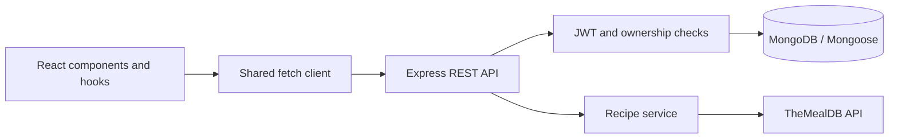

# FridgeChef

**Frontend URL:** [https://fridge-chef-ecru.vercel.app](https://fridge-chef-ecru.vercel.app)

**API URL:** [https://fridgechef-api-xvri.onrender.com](https://fridgechef-api-xvri.onrender.com)

**API health check:** [https://fridgechef-api-xvri.onrender.com/api/health](https://fridgechef-api-xvri.onrender.com/api/health) returns `{"status":"ok"}`.

Make more of what is already in your fridge. A full-stack capstone by **Jovani Bou Khalil, Ralph Alpha, and Mariam Salloum**.

FridgeChef helps students and home cooks find recipes using their pantry, compare missing ingredients, save favorites, and plan shopping. The implementation follows the supplied JavaScript/React and Node/Express course chapters.

## Try the deployed app

Open the **Frontend URL** above and choose **Sign in**. Sign into an existing account or choose **Create an account**; a successful signup signs you in and opens your pantry. You do not need to install anything, create your own Atlas account, or configure a local database to use the deployed app.

For a preview without creating an account, choose **Sign in → Try demo kitchen**. Demo changes stay in that browser and do not demonstrate real authentication or database persistence.

The frontend runs on Vercel, the Express API runs on Render, and the database is hosted on MongoDB Atlas. Render's free service can take about a minute to wake after being idle; allow it to start and retry if the first request times out.

## Features

- Signup, login, logout, expiring JWT sessions, and protected pantry/saved/shopping screens.
- Private pantry: create, search, edit quantities, and delete with confirmation.
- TheMealDB recipe discovery, name search, details, and category filters through the Express API.
- Ingredient alias normalization and recipe ranking by the share of ingredient names available in the pantry.
- Recipe details with quantities, available/missing ingredients, instructions, and original/video links.
- Saved recipes and a shopping checklist generated from missing ingredients, with duplicate prevention.
- Featured recipe carousel built with React state, JSX, CSS animations, and the existing SVG icon component.
- Desktop and mobile layouts, keyboard navigation, reduced motion, loading/error/retry states, and form feedback.
- An explicitly labeled demo kitchen with local sample data for reviewing the interface without database credentials.

Matching compares ingredient names. It does not infer quantities, nutrition, allergies, or cooking times. The free provider supports bounded ingredient-based candidate searches, rather than an exhaustive search of every recipe.

## Stack and architecture

Application code uses **HTML, plain CSS, JavaScript/JSX, React, React Router, Vite, Node.js, Express, MongoDB/Mongoose, bcrypt, and JWT**. CORS, Helmet, and express-rate-limit implement the API controls taught in Chapters 17 and 21. Vitest, React Testing Library, and Playwright are development verification tools. All application source files are JavaScript/JSX; the carousel uses the same stack as the other screens.



The API owns password hashing, signing secrets, database credentials, and per-user queries. Public recipe calls omit the private bearer token. Private data reloads from MongoDB after writes; logout or account changes discard the previous user's React state.

```text
client/
  src/api/          Shared HTTP and recipe services
  src/auth/         Auth provider and protected routes
  src/components/   Reusable controls, cards, and featured carousel
  src/context/      Shared kitchen state and API mutations
  src/hooks/        Loading, error, request cleanup, and reload hooks
  src/pages/        Route screens
  src/utils/        Validation, storage parsing, and ingredient matching
  e2e/              Desktop/mobile browser checks
server/
  config/           MongoDB and JWT configuration
  controllers/      Public recipe request handling
  middleware/       Authentication and safe error responses
  models/           User-owned Mongoose schemas and indexes
  routes/           Authentication, pantry, favorites, shopping, recipes
  services/         TheMealDB HTTP integration
  validation/       Shared request validation schemas
  test/, tests/     Backend request and schema tests
scripts/            Live deployment acceptance check
```

## Run the full app locally

### 1. Prerequisites

- **Node.js 24.x and npm**. Check with `node --version` and `npm --version`.
- **Git** to clone or update the repository.
- A reachable **MongoDB database**: either the team's existing Atlas database or an already running local MongoDB instance.
- Internet access for dependency installation and live TheMealDB recipes.

If your teammate manages Atlas, ask them privately for an application database user's connection URI and have them allow your computer's public IP in Atlas Network Access. You do not need their Atlas website password or your own Atlas account. MongoDB does not need to be installed on your computer when using Atlas. Your local API still needs a working connection URI to start.

**Working directory:** after cloning, run all commands below from the `FridgeChef` repository root, the folder containing `client/` and `server/`, unless a step explicitly says otherwise. There is no root `package.json`; the commands use `--prefix` to select the correct application.

**Windows PowerShell:** if `npm` or `npx` is blocked because script execution is disabled, use `npm.cmd` or `npx.cmd` in the commands below.

### 2. Get the code and install dependencies

For a new checkout:

```sh
git clone https://github.com/JovaniBouKhalil/FridgeChef.git
cd FridgeChef
```

For an existing checkout, open a terminal in its repository root, save any local work, and update `main`:

```sh
git switch main
git pull --ff-only
```

Install both applications, whether you cloned or updated:

```sh
npm --prefix server ci
npm --prefix client ci
```

### 3. Create the local environment files

From the repository root in **PowerShell**:

```powershell
if (-not (Test-Path client/.env)) { Copy-Item client/.env.example client/.env }
if (-not (Test-Path server/.env)) { Copy-Item server/.env.example server/.env }
```

For **macOS/Linux**:

```sh
if [ ! -f client/.env ]; then cp client/.env.example client/.env; fi
if [ ! -f server/.env ]; then cp server/.env.example server/.env; fi
```

These commands preserve existing `.env` files. Both files are ignored by Git; only the `.env.example` templates are committed.

In **`client/.env`**, use the local API origin:

```dotenv
VITE_API_URL=http://localhost:3000
```

In **`server/.env`**, replace the `MONGODB_URI` placeholder with the private, complete URI supplied by your teammate. For an already running local MongoDB instance, you can instead use:

```dotenv
MONGODB_URI=mongodb://127.0.0.1:27017/fridgechef
```

Copying the example file does not create a database or configure valid Atlas credentials. Atlas must have a database user with read/write permission and network access for this computer. Use the `fridgechef` database name in its URI; percent-encode special characters in a database password if assembling the URI yourself.

Generate a **local JWT signing secret**:

```sh
node -e "console.log(require('node:crypto').randomBytes(32).toString('hex'))"
```

Paste the generated value after `JWT_SECRET=` in **`server/.env`**. Keep the remaining local settings as follows:

| Server variable    | Local value / purpose                          |
| ------------------ | ---------------------------------------------- |
| `MONGODB_URI`      | Your working Atlas URI, or the local URI above |
| `JWT_SECRET`       | The generated random value; at least 32 bytes  |
| `JWT_EXPIRES_IN`   | `1d`                                           |
| `CLIENT_ORIGIN`    | `http://localhost:5173`                        |
| `PORT`             | `3000`                                         |
| `TRUST_PROXY_HOPS` | `0`                                            |
| `MEALDB_URL`       | `https://www.themealdb.com/api/json/v1/1`      |

Database credentials and the JWT signing secret belong only in `server/.env`. Values beginning with `VITE_` are included in the browser application and must be public. Restart the relevant development server after changing its environment file.

### 4. Start the API

Open **terminal 1 in the repository root**:

```sh
npm --prefix server run dev
```

Keep this terminal open. A successful start prints:

```text
Connected to MongoDB.
FridgeChef API listening on http://localhost:3000
```

Open [http://localhost:3000/api/health](http://localhost:3000/api/health). Expect `{"status":"ok"}`. The API connects to MongoDB before it starts listening; a missing/short JWT secret or unreachable database must be fixed before continuing.

### 5. Start the frontend

Open **terminal 2 in the same repository root**:

```sh
npm --prefix client run dev
```

Keep both terminals running and open [http://localhost:5173](http://localhost:5173). If Vite chooses another port, change `CLIENT_ORIGIN` in `server/.env` to match that exact origin and restart the API. Use `Ctrl+C` in each terminal to stop the applications.

For local development, keep `VITE_API_URL` pointing to your local API. The hosted Render API allows the production Vercel origin, so pointing a local frontend at it will cause CORS errors.

### 6. Confirm the real app works

Outside demo mode:

1. Create an account, log out, and sign back in.
2. Add an ingredient, edit its quantity, and refresh to confirm the saved value remains.
3. Search for a recipe, open its details, and compare available/missing ingredients.
4. Save a recipe, generate a shopping list, check an item, and refresh again.
5. Sign in with a second account and confirm the first account's records are absent.

## Run the demo without database credentials

After cloning, install and start only the frontend from the repository root:

```sh
npm --prefix client ci
npm --prefix client run dev
```

Open [http://localhost:5173/login](http://localhost:5173/login) and choose **Try demo kitchen**. No API process, `server/.env`, MongoDB connection, or real account is needed for this mode. It uses eight recipe snapshots and separate browser storage. Exit demo before checking authentication or database persistence.

## Verification

From the repository root:

```sh
npm --prefix client run lint
npm --prefix client test
npm --prefix server test
```

For browser checks, start from the repository root:

```sh
cd client
npx playwright install chromium
cd ..
npm --prefix client run test:e2e -- --workers=2
```

Playwright starts the local Vite server automatically. Keep the default local API URL when running browser tests; their fixtures target `http://localhost:3000`. Alternatively, use an installed Chrome browser: in PowerShell set `$env:PLAYWRIGHT_CHANNEL = 'chrome'` before the browser command. The automated tests use fixtures/injected models; they do not need MongoDB or server credentials. Normal application mode uses the real API.

Checks run on pushes and pull requests through GitHub Actions. Tests cover ingredient ranking, auth headers/expiry, validation, owner-scoped CRUD, duplicate prevention, upstream errors, security headers/rate limits, and desktop/mobile interactions. Responsive checks include 320, 360, 430, and 768px viewports.

## Build and deploy

For a local production build, create **`client/.env.production.local`** with this public value. This file is ignored by Git and leaves your development `client/.env` unchanged:

```dotenv
VITE_API_URL=https://fridgechef-api-xvri.onrender.com
```

Then run from the repository root:

```sh
npm --prefix client run build
```

The static output is **`client/dist`**. A build rejects a missing, HTTP, or localhost API origin. You can inspect the compiled frontend with `npm --prefix client run preview`, normally at `http://localhost:4173`. The hosted API allows the production Vercel origin, so use the deployed app for production API flows or the full local development setup above for local API flows.

The deployed services use these settings:

| Host   | Setting                         | Value                                      |
| ------ | ------------------------------- | ------------------------------------------ |
| Vercel | Branch / root / framework       | `main` / `client` / Vite                   |
| Vercel | Install / build / output        | `npm ci` / `npm run build` / `dist`        |
| Vercel | `VITE_API_URL`                  | `https://fridgechef-api-xvri.onrender.com` |
| Render | Branch / root                   | `main` / `server`                          |
| Render | Build / start                   | `npm ci` / `npm start`                     |
| Render | `CLIENT_ORIGIN`                 | `https://fridge-chef-ecru.vercel.app`      |
| Render | `NODE_ENV` / `TRUST_PROXY_HOPS` | `production` / `1`                         |
| Render | Health check                    | `/api/health`                              |

Use Node.js 24 on both hosts. Render supplies `PORT`; set the private Atlas URI and a separate production JWT secret in Render's environment settings. Keep `JWT_EXPIRES_IN=1d` and the same public `MEALDB_URL` as local development.

On Vercel, store `VITE_API_URL` as **Config** and redeploy after changing it. Use the exact API origin above without `/api` or a trailing slash. On Render, `CLIENT_ORIGIN` must exactly match the frontend origin, without a trailing slash; redeploy after changing it. The project's setting is named `CLIENT_ORIGIN`, although the chapter's example calls it `CLIENT_URL`. The committed Vercel rewrite supports direct page refreshes.

### Troubleshooting

| Symptom                                                             | What to check                                                                                                                 |
| ------------------------------------------------------------------- | ----------------------------------------------------------------------------------------------------------------------------- |
| `npm` is blocked in PowerShell                                      | Run the same command with `npm.cmd`; use `npx.cmd` for `npx`.                                                                 |
| npm cannot find `package.json`                                      | Run the documented `npm --prefix client ...` or `npm --prefix server ...` command from the repository root.                   |
| API exits immediately                                               | Read terminal 1: fill `JWT_SECRET` and replace the MongoDB placeholder with a reachable URI.                                  |
| MongoDB connection fails                                            | Check database credentials, read/write permission, and Atlas Network Access for this computer or Render's outbound IP ranges. |
| API health works but the frontend shows CORS errors                 | Local `CLIENT_ORIGIN` must match Vite's exact URL. Production must use the two hosted origins in the table above.             |
| Frontend requests localhost or an example hostname after deployment | Correct Vercel's production `VITE_API_URL`, then redeploy. Environment changes do not update an existing build.               |
| Recipe requests fail                                                | Confirm API health and TheMealDB access, then use the UI's retry action.                                                      |
| First request to the live app times out                             | Allow the free Render service to wake, then retry.                                                                            |
| A private page redirects to sign-in                                 | Log in again; sessions expire after one day by default. Demo mode is separate from a real account.                            |
| Login returns 429                                                   | Wait for the 15-minute failed-login limit to reset.                                                                           |
| Refreshing a deployed app route gives 404                           | Confirm Vercel's root is `client` so `client/vercel.json` is included.                                                        |

## Deployment and submission evidence

The frontend and API are publicly deployed at the URLs at the top of this README. Live checks on **18 November 2026** verified signup/login, owner isolation, pantry CRUD and persisted re-reads, recipe search, favorites, shopping generation/deduplication, checkbox persistence, and deep-link refreshes. Browser checks used the real deployed API on desktop and an emulated mobile viewport. A physical phone on mobile data and the final live presentation remain manual checks.

The repository includes the Vercel SPA rewrite, Render Blueprint, CI workflow, and a reproducible live verifier. To run the verifier against the current deployment from the repository root:

```sh
node scripts/verify-deployment.mjs https://fridge-chef-ecru.vercel.app https://fridgechef-api-xvri.onrender.com
```

This command writes to the live database: it creates two labeled test accounts and temporary pantry/favorite/shopping records. It removes those resource records afterward; the two accounts remain because there is no account-deletion endpoint. Passwords and tokens stay in memory and are not printed.

Use [Chapter 23 deployment](docs/DEPLOYMENT.md) as the detailed hosting setup reference. The milestone/security/performance documents below also contain earlier audit snapshots; the live verification summary above records the deployed checks.

- [Requirements and milestone audit](docs/CAPSTONE_MILESTONES.md): exact chapter references, implementation evidence, and outstanding live checks.
- [Final wireframes and database schema](docs/DESIGN.md): every main screen, navigation arrows, fields, types, indexes, and references.
- [API contract](docs/API_CONTRACT.md) and [frontend/course guide](docs/FRONTEND_GUIDE.md): routes, payloads, and course patterns.
- [Security review](SECURITY.md): three measured before/fix/after findings.
- [Performance evidence](PERFORMANCE.md): production build and Lighthouse comparison.
- [Presentation outline](docs/PRESENTATION.md): a seven-minute walkthrough and Q&A preparation.
- [Featured carousel](docs/DISH_ORBIT_CAROUSEL.md): plain React/CSS implementation details.

## Attribution

Recipe contents and food photographs come from [TheMealDB](https://www.themealdb.com), using its public educational API. Eight local snapshots and images support the clearly labeled demo kitchen; normal mode loads live recipe contents through Express. The local Outfit font includes its license in `client/public/fonts/`. Backdrop attribution is in `client/public/images/orbit/README.md`.
