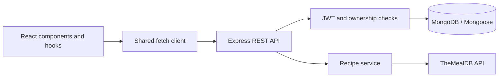

# FridgeChef

**Frontend URL:** [https://fridge-chef-ecru.vercel.app](https://fridge-chef-ecru.vercel.app)

**API URL:** [https://fridgechef-api-xvri.onrender.com](https://fridgechef-api-xvri.onrender.com)

**API health check:** [https://fridgechef-api-xvri.onrender.com/api/health](https://fridgechef-api-xvri.onrender.com/api/health) returns `{"status":"ok"}`.

Make more of what is already in your fridge. A full-stack capstone by **Jovani Bou Khalil, Ralph Alpha, and Mariam Salloum**.

FridgeChef helps students and home cooks find recipes using their pantry, compare missing ingredients, save favorites, and plan shopping. The implementation follows the supplied JavaScript/React and Node/Express course chapters.

## Try the deployed app

Open the **Frontend URL** above and choose **Sign in**. Sign into an existing account or choose **Create an account**; a successful signup signs you in and opens your pantry. You do not need to install anything, create your own Atlas account, or configure a database to use the deployed app.

For a preview without creating an account, choose **Sign in → Try demo kitchen**. Demo changes stay in that browser and do not demonstrate real authentication or database persistence.

The frontend runs on Vercel, the Express API runs on Render, and the database is hosted on MongoDB Atlas. Render's free service can take about a minute to wake after being idle; allow it to start and retry if the first request times out.

## Features

- Signup, login, logout, expiring JWT sessions, and protected pantry/saved/shopping screens.
- Private pantry: create, search, edit quantities with a unit dropdown (including no unit), and delete with confirmation.
- TheMealDB recipe discovery, name search, details, and category filters through the Express API.
- General ingredient normalization (case, spacing, accents, hyphens, English plurals, and common spelling variants) and recipe ranking by the share of ingredient names available in the pantry.
- Recipe details with quantities, available/missing ingredients, instructions, and original/video links.
- Saved recipes and a shopping checklist generated from missing ingredients, with duplicate prevention and automatic pantry additions when items are checked off.
- Featured recipe carousel built with React state, JSX, CSS animations, and the existing SVG icon component.
- Desktop and mobile layouts, keyboard navigation, reduced motion, loading/error/retry states, and form feedback.
- An explicitly labeled demo kitchen with bundled sample data for reviewing the interface without database credentials.

Matching compares ingredient names. It does not infer quantities, nutrition, allergies, or cooking times. The free provider supports bounded ingredient-based candidate searches, rather than an exhaustive search of every recipe.

## Stack and architecture

Application code uses **HTML, plain CSS, JavaScript/JSX, React, React Router, Vite, Node.js, Express, MongoDB/Mongoose, bcrypt, JWT, and Zod**. Zod validates request bodies. CORS, Helmet, and express-rate-limit implement the API controls taught in Chapters 17 and 21. Vitest, React Testing Library, and Playwright are development verification tools. All application source files are JavaScript/JSX; the carousel uses the same stack as the other screens.



The API owns password hashing, signing secrets, database credentials, and per-user queries. Public recipe calls omit the private bearer token. Private writes update React state from the API response; checking a shopping item also refreshes the pantry. Refreshing a page reloads persisted records from MongoDB. Logout or account changes discard the previous user's React state.

```text
client/
  src/api/          Shared HTTP and recipe services
  src/auth/         Auth provider and protected routes
  src/components/   Reusable controls, cards, and featured carousel
  src/context/      Shared kitchen state and API mutations
  src/hooks/        Loading, error, request cleanup, and reload hooks
  src/pages/        Route screens
  src/utils/        Validation, storage parsing, and ingredient matching
  e2e/              Desktop/mobile browser checks
server/
  config/           MongoDB and JWT configuration
  controllers/      Public recipe request handling
  middleware/       Authentication and safe error responses
  models/           User-owned Mongoose schemas and indexes
  routes/           Authentication, pantry, favorites, shopping, recipes
  services/         TheMealDB HTTP integration
  validation/       Shared request validation schemas
  test/, tests/     Backend request and schema tests
scripts/            Live deployment acceptance check
```

## Use FridgeChef

1. Open [FridgeChef](https://fridge-chef-ecru.vercel.app) in your browser.
2. Choose **Sign in** or **Create an account**. Signup signs you in and opens your pantry.
3. In **My pantry**, add ingredients and quantities, choosing a measurement from **Unit** or **No unit** for counts. Edit or remove entries as needed; changes are saved to your account.
4. Open **Discover recipes**, search by name, and enable **Pantry matches** to rank recipes using your ingredients.
5. Open a recipe to see measurements, instructions, and available/missing ingredients. Save it with the heart button.
6. Choose **Add missing to shopping list**, then open **Shopping** to check off items or clear picked-up items. Checked items are added to your pantry automatically; set their quantities there after shopping. Existing pantry quantities are kept.
7. Refresh a page to reload saved data. Sign out when finished; each account has its own pantry, favorites, and shopping list.

For sample data without signing up, open **Sign in → Try demo kitchen** on the deployed site. The banner identifies demo mode, and its changes stay in that browser. Exit demo before checking real authentication or database persistence.

## Hosted setup and configuration

The deployed application uses **Vercel + Render + MongoDB Atlas**. The following settings describe the current deployment and how to reproduce it from this repository.

### 1. Database on MongoDB Atlas

Use the team's existing Atlas cluster. The teammate who manages it can configure database access without sharing their Atlas website password.

- Create an application database user with read/write access to the `fridgechef` database.
- Add the Render service's outbound IP ranges to Atlas Network Access.
- Copy the complete driver connection URI into Render's private `MONGODB_URI` environment setting. Include the `fridgechef` database name and encode special characters in the password when assembling a URI.

People using the deployed website do not need database credentials or their own Atlas account.

### 2. API on Render

Connect the GitHub repository to a Render Node Web Service, or import the committed [Render Blueprint](render.yaml).

| Setting                   | Value                                      |
| ------------------------- | ------------------------------------------ |
| Branch                    | `main`                                     |
| Root directory            | `server`                                   |
| Node.js version           | `24`                                       |
| Build command             | `npm ci`                                   |
| Start command             | `npm start`                                |
| Health check path         | `/api/health`                              |
| Current public API origin | `https://fridgechef-api-xvri.onrender.com` |

Set these variables in Render's environment settings:

| Variable           | Production value                                                            |
| ------------------ | --------------------------------------------------------------------------- |
| `NODE_ENV`         | `production`                                                                |
| `MONGODB_URI`      | The team's private Atlas connection URI                                     |
| `JWT_SECRET`       | A random signing secret of at least 32 bytes; the Blueprint can generate it |
| `JWT_EXPIRES_IN`   | `1d`                                                                        |
| `CLIENT_ORIGIN`    | `https://fridge-chef-ecru.vercel.app`                                       |
| `TRUST_PROXY_HOPS` | `1`                                                                         |
| `MEALDB_URL`       | `https://www.themealdb.com/api/json/v1/1`                                   |

Render supplies `PORT`. The server connects to MongoDB before it starts listening. After deployment, open the [API health check](https://fridgechef-api-xvri.onrender.com/api/health) and expect `{"status":"ok"}`.

The project's setting is named `CLIENT_ORIGIN`; the chapter's example calls it `CLIENT_URL`. Use the project's name above. Save and redeploy the API after changing its environment settings.

### 3. Frontend on Vercel

Import the same GitHub repository and select **Import single project** beside **client (Vite)**.

| Setting                        | Value                                 |
| ------------------------------ | ------------------------------------- |
| Branch                         | `main`                                |
| Root directory                 | `client`                              |
| Framework                      | Vite                                  |
| Node.js version                | `24`                                  |
| Install command                | `npm ci`                              |
| Build command                  | `npm run build`                       |
| Output directory               | `dist`                                |
| Current public frontend origin | `https://fridge-chef-ecru.vercel.app` |

Add the following environment variable as **Config** for **Production**:

```dotenv
VITE_API_URL=https://fridgechef-api-xvri.onrender.com
```

Use the API origin without `/api` or a trailing slash. This address is public: `VITE_` values are included in the browser application. Database credentials and the JWT signing secret belong only on Render.

Save and **redeploy the frontend** after changing `VITE_API_URL`; an existing build keeps its previous value. On Render, `CLIENT_ORIGIN` must exactly match the stable Vercel frontend origin, without a trailing slash. If you reproduce the deployment under different domains, update both variables to those actual domains.

The committed [Vercel configuration](client/vercel.json) rewrites app routes to `index.html`, so directly opening or refreshing `/pantry`, `/featured`, or a recipe URL loads the app. Use the stable production URL for the submitted project.

## Verification

The [current acceptance report](docs/ACCEPTANCE.md) records checks for the final feedback update. The team reports a **9/10 presentation score**; this is the presentation result, not a claim about the overall project grade.

### Automated checks

[GitHub Actions](.github/workflows/ci.yml) runs on pushes and pull requests. It installs each application's dependencies and runs frontend lint, frontend unit tests, a production compile check, desktop/mobile browser tests, and backend tests.

Coverage includes ingredient matching, authentication headers and expiry, validation, owner-scoped CRUD, duplicate prevention, upstream errors, security headers, and rate limits. Responsive checks cover widths of 320, 360, 430, and 768 pixels. Automated unit/browser suites use fixtures and injected models; the deployment checks below exercise the real services.

### Live deployment checks

Live checks on **18 November 2026** verified signup/login, owner isolation, pantry CRUD and persisted re-reads, recipe search, favorites, shopping generation/deduplication, checkbox persistence, and deep-link refreshes. Browser checks used the real deployed API on desktop and an emulated mobile viewport. A physical phone on mobile data and the final live presentation remain manual checks.

To reproduce the API acceptance check, use Node.js 24 and a checkout of this repository. Run this command from the repository root; it targets the public frontend and API:

```sh
node scripts/verify-deployment.mjs https://fridge-chef-ecru.vercel.app https://fridgechef-api-xvri.onrender.com
```

This verifier creates two labeled test accounts and temporary pantry/favorite/shopping records in the hosted database. It removes those resource records afterward; the two accounts remain because the application has no account-deletion endpoint. Passwords and tokens stay in memory and are not printed.

For a manual acceptance check, follow the website walkthrough above, refresh after saving changes, and use a second account to confirm the first account's records are absent.

## Deployment troubleshooting

| Symptom                                    | What to check                                                                                                  |
| ------------------------------------------ | -------------------------------------------------------------------------------------------------------------- |
| API does not start                         | Check Render logs, a valid Atlas URI, a sufficiently long `JWT_SECRET`, and `CLIENT_ORIGIN`.                   |
| MongoDB connection fails                   | Check the database user's credentials/permissions and Atlas Network Access for Render's outbound IP ranges.    |
| Browser reports CORS errors                | Set Render's `CLIENT_ORIGIN` to `https://fridge-chef-ecru.vercel.app`, without a trailing slash, and redeploy. |
| Frontend requests an incorrect API address | Set Vercel's production `VITE_API_URL` to `https://fridgechef-api-xvri.onrender.com` and redeploy.             |
| First request times out                    | Allow the free Render service to wake after being idle, then retry.                                            |
| Recipe search fails                        | Confirm the API health check and TheMealDB availability, then use the page's retry action.                     |
| Private page redirects to sign-in          | Sign in again; sessions expire after one day by default.                                                       |
| Login returns 429                          | Wait for the 15-minute failed-login limit to reset.                                                            |
| Refreshing an app route gives 404          | Confirm Vercel's root directory is `client` so `client/vercel.json` is included.                               |

## Supporting documentation

The following documents explain the implementation and course deliverables. Milestone, security, and performance reports include historical audit snapshots; the deployed URLs and live verification summary in this README describe the published application.

- [Requirements and milestone audit](docs/CAPSTONE_MILESTONES.md): course references, checkpoint history, and submission evidence.
- [Final wireframes and database schema](docs/DESIGN.md): screens, navigation, fields, types, indexes, and references.
- [Current acceptance report](docs/ACCEPTANCE.md): teacher feedback coverage, automated checks, live verification, and remaining manual checks.
- [API contract](docs/API_CONTRACT.md) and [frontend/course guide](docs/FRONTEND_GUIDE.md): routes, payloads, and course patterns.
- [Security review](SECURITY.md): security controls and measured before/fix/after findings.
- [Performance evidence](PERFORMANCE.md): build and Lighthouse comparisons.
- [Presentation outline](docs/PRESENTATION.md): a seven-minute walkthrough and Q&A preparation.
- [Featured carousel](docs/DISH_ORBIT_CAROUSEL.md): React/CSS implementation details.

## Attribution

Recipe contents and food photographs come from [TheMealDB](https://www.themealdb.com), using its public educational API. Eight bundled snapshots and images support the clearly labeled demo kitchen; normal mode loads live recipe contents through Express. The bundled Outfit font includes its license in `client/public/fonts/`. Backdrop attribution is in `client/public/images/orbit/README.md`.
