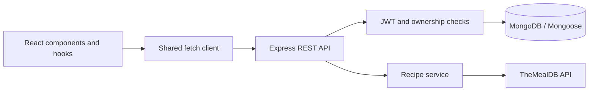

# FridgeChef

**Frontend URL:** Pending deployment

**API URL:** Pending deployment

Make more of what is already in your fridge. A full-stack capstone by **Jovani Bou Khalil, Ralph Alpha, and Mariam Salloum**.

FridgeChef helps students and home cooks find recipes using their pantry, compare missing ingredients, save favorites, and plan shopping. The implementation follows the supplied JavaScript/React and Node/Express course chapters.

## Features

- Signup, login, logout, expiring JWT sessions, and protected pantry/saved/shopping screens.
- Private pantry: create, search, edit quantities, and delete with confirmation.
- TheMealDB recipe discovery, name search, details, and category filters through the Express API.
- Ingredient alias normalization and recipe ranking by the share of ingredient names available in the pantry.
- Recipe details with quantities, available/missing ingredients, instructions, and original/video links.
- Saved recipes and a shopping checklist generated from missing ingredients, with duplicate prevention.
- Featured recipe carousel built with React state, JSX, CSS animations, and the existing SVG icon component.
- Desktop and mobile layouts, keyboard navigation, reduced motion, loading/error/retry states, and form feedback.
- An explicitly labeled demo kitchen with local sample data for reviewing the interface without database credentials.

Matching compares ingredient names. It does not infer quantities, nutrition, allergies, or cooking times. The free provider supports bounded ingredient-based candidate searches, rather than an exhaustive search of every recipe.

## Stack and architecture

Application code uses **HTML, plain CSS, JavaScript/JSX, React, React Router, Vite, Node.js, Express, MongoDB/Mongoose, bcrypt, and JWT**. CORS, Helmet, and express-rate-limit implement the API controls taught in Chapters 17 and 21. Vitest, React Testing Library, and Playwright are development verification tools. All application source files are JavaScript/JSX; the carousel uses the same stack as the other screens.



The API owns password hashing, signing secrets, database credentials, and per-user queries. Public recipe calls omit the private bearer token. Private data reloads from MongoDB after writes; logout or account changes discard the previous user's React state.

```text
client/
  src/api/          Shared HTTP and recipe services
  src/auth/         Auth provider and protected routes
  src/components/   Reusable controls, cards, and featured carousel
  src/context/      Shared kitchen state and API mutations
  src/hooks/        Loading, error, request cleanup, and reload hooks
  src/pages/        Route screens
  src/utils/        Validation, storage parsing, and ingredient matching
  e2e/              Desktop/mobile browser checks
server/
  config/           MongoDB and JWT configuration
  controllers/      Public recipe request handling
  middleware/       Authentication and safe error responses
  models/           User-owned Mongoose schemas and indexes
  routes/           Authentication, pantry, favorites, shopping, recipes
  services/         TheMealDB HTTP integration
  test/, tests/     Backend request and schema tests
scripts/            Live deployment acceptance check
```

## Local setup

Use **Node.js 24 and npm**, plus a working MongoDB instance or Atlas connection. Clone this repository, then install each side separately:

```sh
git clone https://github.com/JovaniBouKhalil/FridgeChef.git
cd FridgeChef
npm --prefix client ci
npm --prefix server ci
```

If you already have the repository, save any local work, switch to `main` with `git switch main`, then run `git pull --ff-only` from its root instead of cloning it again. Keep your existing `.env` files and run both `npm ci` commands above.

For a fresh setup, copy the example configuration files. These PowerShell commands run from the repository root and preserve any existing `.env` files:

```powershell
if (-not (Test-Path client/.env)) { Copy-Item client/.env.example client/.env }
if (-not (Test-Path server/.env)) { Copy-Item server/.env.example server/.env }
```

In macOS/Linux shells, use `cp` for these copies only when the destination file does not already exist.

Replace the MongoDB placeholder in `server/.env` with a real connection URI. For an already running local MongoDB instance, use `mongodb://127.0.0.1:27017/fridgechef`. For Atlas, use the team's private connection URI and allow this computer's IP address in Atlas Network Access.

Generate a JWT secret using Node:

```sh
node -e "console.log(require('node:crypto').randomBytes(32).toString('hex'))"
```

Paste the generated value after `JWT_SECRET=` in `server/.env`. The API intentionally refuses to start with a blank/short secret or an unconfigured database. Keep the other local values as shown:

| Variable | Local value / purpose |
| --- | --- |
| `MONGODB_URI` | Working local MongoDB or Atlas URI for the team's database |
| `JWT_SECRET` | Random secret containing at least 32 bytes |
| `JWT_EXPIRES_IN` | `1d` by default |
| `CLIENT_ORIGIN` | `http://localhost:5173` |
| `PORT` | `3000` |
| `TRUST_PROXY_HOPS` | `0` locally, `1` on Render |
| `MEALDB_URL` | Public educational TheMealDB endpoint from the example |

The frontend example sets `VITE_API_URL=http://localhost:3000`. Vite variables are public; private database/JWT values belong only on the server. Restart Vite after changing frontend environment values.

Open **two terminals in the `FridgeChef` repository root**. Start the API in terminal 1:

```sh
npm --prefix server run dev
```

The API should print `Connected to MongoDB.` and its listening URL. Open `http://localhost:3000/api/health` in a browser; expect `{"status":"ok"}`.

Start the frontend in terminal 2, also from the repository root:

```sh
npm --prefix client run dev
```

Open the Vite URL, normally `http://localhost:5173`. The backend connects to MongoDB before it starts listening. Normal account and recipe features require the configured API; live recipes also need TheMealDB access.

For interface review without backend credentials, choose **Sign in → Try demo kitchen**. Demo mode has eight recipe snapshots and separate browser storage, never creates a real account, and never simulates a JWT. Exit demo before verifying authentication or persistence.

### First-run check

Outside demo mode, create an account, add an ingredient, edit its quantity, and refresh the page. Save a recipe and add its missing ingredients to Shopping. Log out, create a second account, and confirm that the first account's records are absent. This checks the real API/database connection in addition to the automated tests.

If startup fails, check the error shown in the API terminal first. `MONGODB_URI` must point to a reachable database, `JWT_SECRET` must be filled, and `CLIENT_ORIGIN` must exactly match the Vite origin. If Vite selects another port, update `CLIENT_ORIGIN` and restart the API. On Windows, use `npm.cmd` / `npx.cmd` if PowerShell blocks the `.ps1` launchers.

## Verification

From the repository root:

```sh
npm --prefix client run lint
npm --prefix client test
npm --prefix server test
```

For browser checks, from `client/`:

```sh
npx playwright install chromium
npm run test:e2e -- --workers=2
```

Alternatively use an installed Chrome browser: in PowerShell set `$env:PLAYWRIGHT_CHANNEL = 'chrome'` before the browser command. The automated tests use fixtures/injected models; they do not need a local `.env` or MongoDB connection. Browser API mocks are test infrastructure. Normal application mode uses the real API.

A production build needs the actual public HTTPS API origin in `VITE_API_URL`, then `npm run build` from `client/`. Output is `client/dist`. See the deployment guide before publishing; a missing or localhost production API origin is rejected during the build.

Checks run on pushes and pull requests through GitHub Actions. Tests cover ingredient ranking, auth headers/expiry, validation, owner-scoped CRUD, duplicate prevention, upstream errors, security headers/rate limits, and desktop/mobile interactions. Responsive checks include 320, 360, 430, and 768px viewports. The final milestone report records the latest verified results.

A separate [full-stack verification](docs/FULL_STACK_VERIFICATION.md) passed using real MongoDB, the actual `server.js` process, a Chrome browser, and live TheMealDB requests, with no application/API mocks. It checked persistence after an API restart and two-user isolation. Production deployment and the team's own Atlas configuration still need their separate acceptance checks.

## Deployment and submission evidence

Follow [Chapter 23 deployment](docs/DEPLOYMENT.md) for **Vercel + Render + MongoDB Atlas**. The repository includes the Vercel SPA rewrite, Render Blueprint, CI workflow, and `scripts/verify-deployment.mjs`. Production still requires connected hosting accounts, private database settings, two reachable public URLs, and the live two-user check. Update the pending URL entries above after successful publication.

- [Requirements and milestone audit](docs/CAPSTONE_MILESTONES.md): exact chapter references, implementation evidence, and outstanding live checks.
- [Final wireframes and database schema](docs/DESIGN.md): every main screen, navigation arrows, fields, types, indexes, and references.
- [API contract](docs/API_CONTRACT.md) and [frontend/course guide](docs/FRONTEND_GUIDE.md): routes, payloads, and course patterns.
- [Security review](SECURITY.md): three measured before/fix/after findings.
- [Performance evidence](PERFORMANCE.md): production build and Lighthouse comparison.
- [Real database and browser verification](docs/FULL_STACK_VERIFICATION.md): actual authentication, persistence, recipe, and shopping flows.
- [Presentation outline](docs/PRESENTATION.md): a seven-minute walkthrough and Q&A preparation.
- [Featured carousel](docs/DISH_ORBIT_CAROUSEL.md): plain React/CSS implementation details.

## Attribution

Recipe contents and food photographs come from [TheMealDB](https://www.themealdb.com), using its public educational API. Eight local snapshots and images support the clearly labeled demo kitchen; normal mode loads live recipe contents through Express. The local Outfit font includes its license in `client/public/fonts/`. Backdrop attribution is in `client/public/images/orbit/README.md`.
