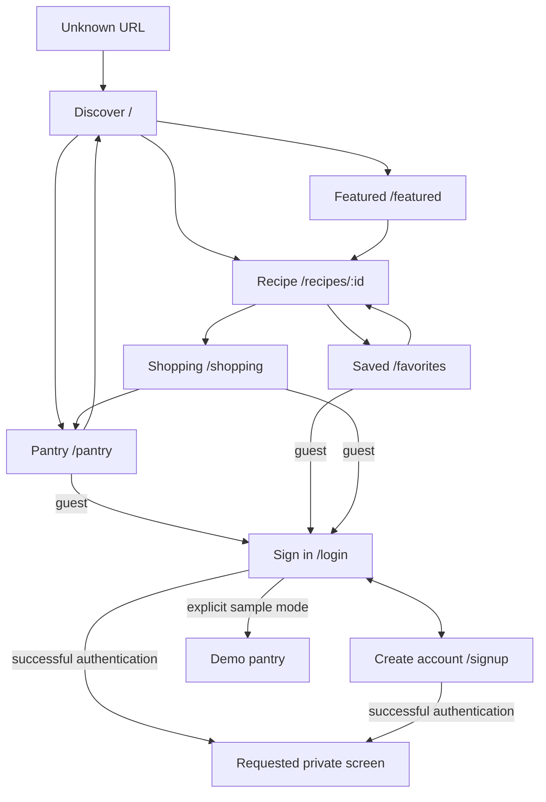
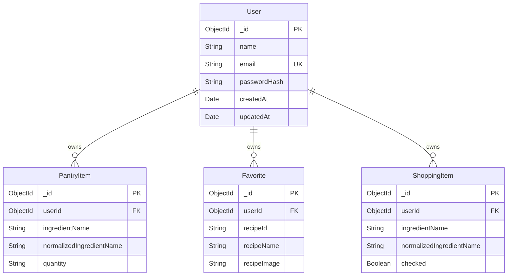

# Final wireframes and database schema

Milestone 1 evidence: Chapter 20, page 3. These low-fidelity wireframes describe the implemented screens. The submitted proposal supplies the original rough schema; this document records the final fields, types, ownership, and navigation.

## Navigation



## Shared shell

Desktop: persistent navigation on the left; breadcrumbs and account/logout above the main content. Mobile: brand/account header, single-column content, fixed bottom navigation with space reserved beneath the page. A labeled banner identifies demo mode. Main navigation links are Discover, Pantry, Saved, and Shopping.

## Main screen wireframes

Each box represents content order. Labels in brackets describe interactive controls.

### Discover — `/`

```text
+---------------------------------------------------------+
| Cook with what you have              [Featured recipes]  |
+------------------------------------+--------------------+
| [Recipe search________________][Go] | Pantry summary     |
| [Category chips] [Pantry matches]    | [Manage pantry]    |
| Loading / error with retry / empty  +--------------------+
| [Recipe card] [Recipe card]         | Featured recipe    |
| [Recipe card] [Recipe card]         | [Open carousel]    |
| [Show more]                        |                    |
+------------------------------------+--------------------+
```

Data: public recipes from Express/TheMealDB; the signed-in user's PantryItems for match percentages. Category filters apply to the loaded results. Cards open full recipe details and expose save actions.

### Recipe details — `/recipes/:id`

```text
+---------------------------------------------------------+
| [Back to Discover]                                      |
| Recipe photo       Title, category, cuisine              |
|                    [Save recipe]                        |
+--------------------------+------------------------------+
| Ingredient / measurement | Numbered cooking instructions|
| Available / missing      | [Original recipe] [Video]    |
| Match percentage         |                              |
| [Add missing to shopping]|                              |
+--------------------------+------------------------------+
```

Data: full TheMealDB recipe; PantryItems for ingredient matching; Favorites for save state; ShoppingItems for deduplication. Missing ingredients are calculated by name, without quantity or dietary assessment.

### Sign in and signup — `/login`, `/signup`

```text
+--------------------------+------------------------------+
| Cooking image and        | Sign in / Create account     |
| introduction             | Name (signup only)           |
|                          | Email                        |
|                          | Password [show/hide]         |
|                          | Confirm password (signup)    |
|                          | Field / server errors        |
|                          | [Submit] [Switch form]       |
|                          | [Try demo kitchen]           |
+--------------------------+------------------------------+
```

Data: signup creates a User; login verifies its password hash. The API returns a JWT and public user profile. The browser stores the token/profile and returns to the requested screen. Passwords are never stored in browser storage. A protected-route redirect preserves the destination.

### Pantry — `/pantry`

```text
+---------------------------------------------------------+
| My pantry                         [Find matching recipes]|
+---------------------------+-----------------------------+
| Add ingredient            | [Search ingredients_______] |
| Ingredient [___________]  | Name, quantity [Edit][Remove]|
| Quantity [____] Unit [v]  | Inline edit [Save][Cancel]  |
| Field errors [Add]        | Removal confirmation        |
+---------------------------+-----------------------------+
```

Data: the authenticated user's PantryItems. Mobile shows the list first; an Add ingredient button opens and focuses the form. The Unit dropdown offers common measurements and No unit for counts. Original ingredient labels are retained for display; canonical keys enforce duplicate prevention and recipe matching. Create, update, and delete are API requests; fresh GET requests reload persisted values.

### Saved recipes — `/favorites`

```text
+---------------------------------------------------------+
| Saved recipes                                           |
| Loading / error with retry / empty guidance              |
| [Photo, recipe name, open details, remove heart]          |
| [Photo, recipe name, open details, remove heart]          |
+---------------------------------------------------------+
```

Data: user-owned Favorites containing the provider recipe ID and display metadata. Full recipe contents are fetched by recipe ID when opened.

### Shopping — `/shopping`

```text
+---------------------------------------------------------+
| Shopping list                 Progress / picked-up count |
| [Ingredient_________________] [Add]                      |
| [ ] Ingredient name                           [Remove] |
| [x] Ingredient name                           [Remove] |
| [Clear picked up]                  [Review your pantry] |
+---------------------------------------------------------+
```

Data: user-owned ShoppingItems. Recipe details can append deduplicated missing ingredients. Checking an item adds it to the owner's pantry if absent, with quantity Not specified; existing pantry quantities remain unchanged. Unchecking or clearing the shopping item leaves pantry records intact. All checklist changes persist through the API.

### Featured recipes — `/featured`

```text
+---------------------------------------------------------+
| Featured recipes                    [Browse all recipes]|
| Recipe 1 / 5                              [Prev] [Next]|
+------------------+-------------------+------------------+
| Circular photo   | Title / cuisine   | [Overview][Items]|
| Swipe supported  | [View] [Video]    | Summary or       |
|                  | [Save recipe]    | ingredient list  |
+------------------+-------------------+------------------+
| [Recipe thumbnail] [Recipe thumbnail] [Recipe thumbnail]|
+---------------------------------------------------------+
```

Data: a fixed selection of provider IDs, with full contents loaded from the real API in normal mode. React state and CSS keyframes implement the carousel. Keyboard arrows, Home/End, tabs, touch gestures, and reduced motion are supported.

### Unknown route

```text
+---------------------------------------------------------+
| We couldn't find that page.                              |
| [Back to the kitchen]                                    |
+---------------------------------------------------------+
```

This screen requires no database record. API failures and empty collections also have explicit states on the relevant screens.

## Database schema

Mongoose model names map to the `users`, `pantryitems`, `favorites`, and `shoppingitems` collections. Every `_id` is generated by MongoDB. References are enforced through authenticated queries and Mongoose ObjectId fields; MongoDB does not automatically cascade deletes.



| Model | Validation and indexes |
| --- | --- |
| User | Name trimmed, 2–100 characters; normalized email up to 254 characters, validated on input; required bcrypt passwordHash excluded from ordinary queries; unique email index; timestamps. Signup passwords require at least 8 characters and at most 72 UTF-8 bytes. |
| PantryItem | Required userId reference; ingredientName 1–80 characters; canonical ingredient key; quantity display string 1–50 characters. Add/edit forms combine the amount with a selected unit, or save the amount alone for No unit. Unique `(userId, normalizedIngredientName)` and userId indexes. |
| Favorite | Required userId reference; numeric provider recipe ID of 1–10 digits; recipeName 1–200 characters; optional image URL up to 2,048 characters, checked for HTTP/HTTPS on input. Unique `(userId, recipeId)` and userId indexes. |
| ShoppingItem | Required userId reference; ingredientName 1–80 characters; canonical ingredient key using the same rules as the pantry; Boolean checked defaults to false. Unique `(userId, normalizedIngredientName)` and userId indexes. |

The server chooses ownership from the verified JWT. Client-supplied userId fields cannot change ownership. Recipe contents belong to TheMealDB and are fetched through the public recipe service instead of being copied into a user collection. Demo browser storage is separate from these collections.
