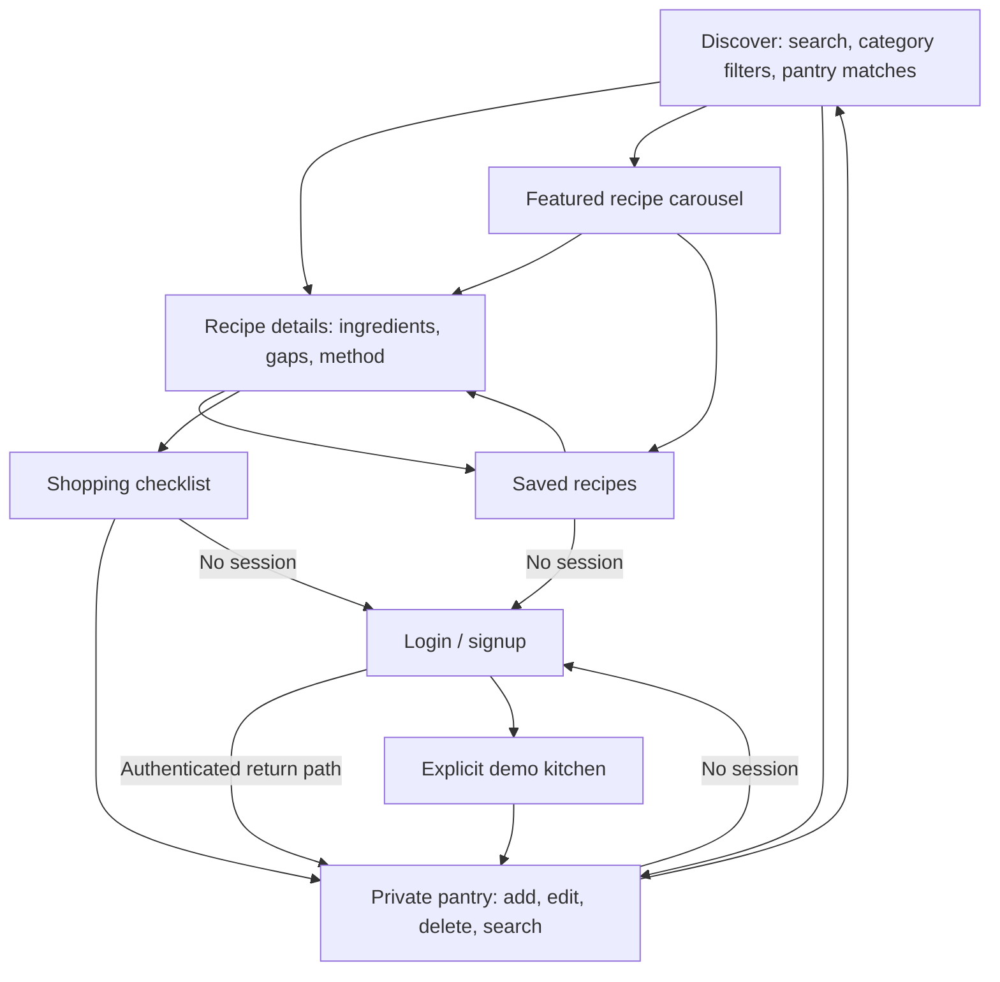

# Frontend guide

## Course alignment

The teacher PDFs were reviewed as project requirements and course references. The final capstone requirements apply to the whole team; the weather-dashboard/to-do exercises inside individual chapters illustrate techniques and are not additional FridgeChef features.

| Course reference | Where it appears in this frontend |
| --- | --- |
| Chapter 12: ES modules, async/await, Vite, npm, Git | JavaScript modules, fetch services, existing Vite client, package scripts, separate frontend branch |
| Chapter 13: JSX, functional components, props, composition | Route screens and reusable `RecipeCard`, `IngredientForm`, `PantryItem`, layout and feedback components |
| Chapter 14: state, events, immutable list changes, stable keys | Controlled inputs, filters, lists keyed by `_id`/recipe ID, demo mutations using map/filter/spread |
| Chapter 15: effects, cleanup, forms, context | Abortable recipe requests, form validation, auth/kitchen contexts, effect cleanup |
| Chapter 17: REST, JSON, status checks, CORS | GET/POST/PATCH/DELETE calls, `response.ok`, 204 handling, API contract |
| Chapter 19: JWT auth and protected routes | Signup/login payloads, bearer header, route protection, logout and private state reset |
| Chapter 20 p. 6: one repo, client/server | Existing `client/` and `server/` folders, two-terminal setup in README |
| Chapter 20 p. 9: shared API client | `src/api/client.js`: config-based origins, automatic token, status/error handling, auth expiry event |
| Chapter 20 p. 10: `useApi` hook | `src/hooks/useApi.js`: data/loading/error/reload, cleanup, re-fetch after writes |
| Chapter 20 pp. 12–14: auth state, provider, expiry | `src/auth/AuthProvider.jsx`, persisted token, `auth:expired` listener and cleanup |
| Chapter 20 pp. 16–17: dev/prod environment | `.env.example`, ignored actual env files, configurable API origins, deployment instructions |
| Final capstone: test, README, responsive UI, client routing | Vitest/RTL + desktop/mobile Playwright tests, root README, CSS breakpoints and React Router |

Chapters 16 and 18 describe the team's Express/Mongoose backend. This branch prepares its integration; it does not implement backend work assigned to other members.

## Screen flow



Protected navigation preserves the requested destination. A 401 from a private API request clears the session. Demo access is explicit, uses separate fixtures/storage, and never accesses the private API. A real login ends demo mode.

## Layout / wireframes

Desktop discovery:

```text
┌──────────────┬─────────────────────────────────────────────┐
│ FridgeChef   │ Breadcrumb                    Sign in/user │
│              ├─────────────────────────────────────────────┤
│ Discover     │ Page heading                                │
│ My pantry    │ ┌───────────────────────────┬─────────────┐ │
│ Saved        │ │ Search, categories, match │ Pantry      │ │
│ Shopping     │ │ Recipe card / recipe card│ summary     │ │
│              │ │ Recipe card / recipe card│ Featured    │ │
│ Pantry help  │ │                           │ recipe      │ │
└──────────────┴─┴───────────────────────────┴─────────────┴─┘
```

Private pantry: add ingredient panel beside a searchable ingredient list. Recipe detail: photo/title above ingredient availability and cooking method columns. Saved recipes: card grid with heart toggles. Shopping: add field, progress and checkboxes beside a pantry reminder. Account: cooking image/story beside the validated form.

On mobile, search appears before recipe results without a large promotional hero. The sidebar becomes bottom navigation and a compact brand header identifies the app. Recipe cards use one column below 400px and two columns on wider phones. The pantry starts with the ingredient list; an accessible Add ingredient control opens the form and focuses its first field. Successful additions close the mobile form and return focus to the list. Account and recipe-detail panels stack. Layouts reserve space for fixed navigation and device safe areas.

The responsive suite exercises all eight main routes, including the later Featured carousel, at 320, 360, 430 and 768px, including long user-entered names and validation errors. It checks for horizontal overflow, 44px control targets, 16px text inputs, and accessible mobile pantry controls. These are browser viewport checks, alongside the desktop/mobile interaction suite.

## Data boundaries

- `AuthProvider` owns token, user and demo access. `useAuth` consumes that context.
- `KitchenProvider` owns private resource hooks and mutations. It is keyed by session; changing users or logging out drops previous user data.
- `useApi` handles one REST collection, cancels obsolete requests, and reloads after mutations.
- `useRecipes` owns recipe search requests, loading/error state, and cleanup when filters change.
- `api/client.js` is the only module that calls `fetch`. Separate origins keep the bearer token away from TheMealDB.
- Local form/filter state stays in its screen or component. Shared kitchen resources use context because navigation, recipes, and multiple screens consume them.
- The demo uses `fridgechef.demoKitchen.v1` in localStorage and `fridgechef.demo` in sessionStorage. Production account data is loaded from the API, never the demo key.

## UI/UX refinements

The [42-prompt review](UI_UX_PROMPT_REVIEW.md) records the selected improvements and deferred ideas. `RecipeSearch` provides a keyboard-accessible combobox, starter ideas and removable local search history. It keeps input focus when a search updates the URL and preserves Back/Forward behavior. Signup, pantry and shopping inputs validate after blur; account and pantry forms reserve space for field feedback and focus the first invalid field on submit.

`Spinner` reflects actual pending operations, while recipe skeletons use the final card layout. Saved hearts animate only after a successful user action. `Layout` supplies clickable breadcrumbs; recipe pages share their loaded title through React Router outlet context. `BackToTop` appears after substantial scrolling, respects reduced motion, returns keyboard focus to the main content, and sits above mobile navigation.

`Reveal` uses IntersectionObserver for a short, one-time panel entrance. Its default is visible content, so missing observers never hide a screen. The styles live in `client/src/interactions.css`, after the main page styles. These initial refinements use browser APIs and keep all existing API/auth boundaries intact.

The later user-supplied Dish Orbit component is integrated as a separate, lazy-loaded Featured route. It adds GSAP, Lucide and a typed TSX UI component, with Tailwind/shadcn-compatible tooling available alongside the existing JavaScript screens. The [integration guide](DISH_ORBIT_CAROUSEL.md) explains the differences from the original component, setup, props and cleanup. Carousel save actions still use the same auth and kitchen contexts; there is no separate account store.

## Proposed database fields for teammates

These follow the submitted proposal; implementation remains with the backend team.

| Collection | Fields | Ownership / uniqueness |
| --- | --- | --- |
| Users | `_id`, `name`, `email`, `passwordHash` | Unique normalized email |
| PantryItems | `_id`, `userId`, `ingredientName`, `quantity` | User reference; normalized ingredient per user |
| Favorites | `_id`, `userId`, `recipeId`, `recipeName`, optional `recipeImage` | Unique user + recipe ID |
| ShoppingItems | `_id`, `userId`, `ingredientName`, `checked` | User reference; normalized ingredient per user |

## Quick review

1. Open `/`, search by recipe name, change category, clear the search, and open a recipe.
2. Open `/pantry` as a guest. Confirm login appears. Try signup with invalid email/short password.
3. Choose Try demo kitchen. On mobile, tap Add ingredient to open the form. Add an ingredient, edit the quantity, remove it, and reload.
4. Open Discover, enable Pantry matches, and inspect the number of ingredients available.
5. Save a recipe. Open Saved recipes and verify it appears; unsave it.
6. Open a recipe and add missing ingredients twice. Confirm the list is not duplicated.
7. Check off an item, reload, clear picked-up items, and add/remove a manual item.
8. Exit demo, confirm private routes return to login, then test the real backend using `API_CONTRACT.md`.
9. Repeat at a narrow viewport and with keyboard navigation. Browser tests automate the central paths.

Ingredient aliases intentionally cover a small, explainable set (e.g. tomatoes → tomato, garlic cloves → garlic). The matcher is not fuzzy AI and does not promise nutritional or allergy analysis. The free recipe API provides no reliable cooking time, so the UI does not invent one. Future micro-animation work should preserve keyboard use, reduced-motion settings, and these functional states.
